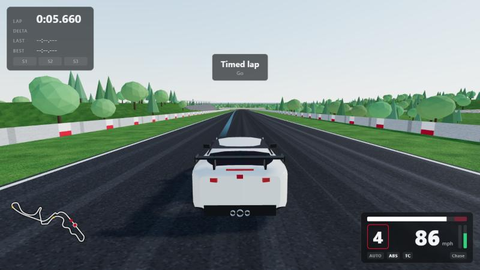
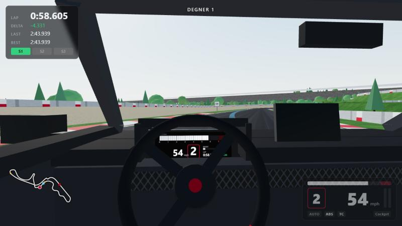

# Type R Racer

A behind-the-wheel driving simulator for the browser, built around the Honda
Civic Type R (FL5) at Suzuka. Project owner: **evilgouki**.

This is the first milestone: one car, one circuit, a timed lap with a ghost.

**Play it in the browser:** https://dragoonant.github.io/type-r-racer/




## Run it

```bash
npm install
```

```bash
npm run dev
```

Then open http://localhost:5183 in a desktop browser. Chrome or Edge is
recommended for gamepad vibration.

Other commands:

| Command | What it does |
|---|---|
| `npm test` | Checks the physics against published FL5 figures and runs an autopilot lap |
| `npm run build` | Builds a static site into `dist/` |
| `npm run track:fetch` | Re-downloads the map and elevation data |
| `npm run track:build` | Rebuilds the track files from that data |

## Controls

| | Keyboard | Gamepad |
|---|---|---|
| Steer | A D or arrow keys | Left stick |
| Throttle / brake | W S or arrow keys | Right / left trigger |
| Handbrake | Space | A |
| Shift up / down | E / Q | B / X |
| Camera | C | RB |
| Look back | V | Y |
| Look left / right | , . | Right stick |
| Back to track | R | View |
| Pause | Esc | Menu |

In play: M gearbox, B anti-lock brakes, T traction control, L driving line,
G ghost, U units.

## What is in it

- **Physics:** 500 Hz rigid-body model with a combined-slip tyre model, load
  transfer, turbo lag, clutch, six-speed gearbox and limited-slip differential.
- **Circuit:** the real layout and elevation, from OpenStreetMap and Japanese
  government lidar data. 5,799 m, 18 corners, the crossover on two levels.
- **Time trial:** lap and sector timing, live delta, best lap saved in the
  browser, and a ghost of the best lap.
- **Views:** cockpit with a working instrument cluster, chase, bonnet, bumper.
- **Aids:** anti-lock brakes, traction control, automatic gearbox, driving line.

## Project layout

```
src/physics/    vehicle dynamics (runs in Node and the browser)
src/track/      track model shared by physics and rendering
src/render/     Three.js scene: circuit, car, cockpit, cameras
src/game/       input, timing, ghost, HUD, audio, racing line, autopilot
src/config/     car specification and all real-world names
tools/          track data pipeline and headless tests
```

See [DECISIONS.md](DECISIONS.md) for why things are the way they are and what
is still missing, and [CREDITS.md](CREDITS.md) for data and sound sources.

## Status

Unofficial fan project. Not affiliated with or endorsed by Honda or Suzuka
Circuit. Real names are kept in `src/config/branding.js` so they can be changed
in one place before any public release.
